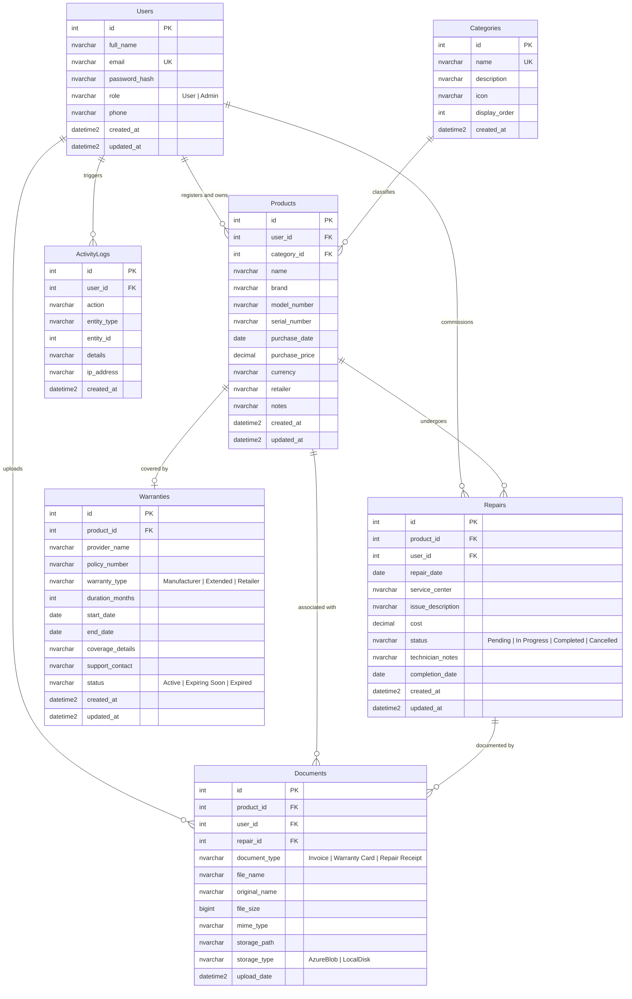

# WarrantyWise — Database Design Document

## 1. Relational Database Normalization (Third Normal Form - 3NF)

The WarrantyWise database schema is designed to adhere strictly to **Third Normal Form (3NF)** rules to eliminate redundant data, prevent update/insert/delete anomalies, and enforce strict referential integrity.

### 1.1 Normalization Breakdown

1. **First Normal Form (1NF)**:
   - All attributes contain atomic, indivisible values (e.g. `full_name`, `email`, separate `start_date` and `end_date`).
   - Every table features a declared clustered Primary Key (`id INT IDENTITY(1,1)`).
   - No repeating groups or multivalued arrays are stored in table columns.

2. **Second Normal Form (2NF)**:
   - All tables satisfy 1NF requirements.
   - All non-key attributes are fully functionally dependent on the entire primary key, eliminating partial dependencies.

3. **Third Normal Form (3NF)**:
   - All tables satisfy 2NF requirements.
   - There are no transitive dependencies: non-key attributes depend exclusively on the candidate key and not on other non-key attributes (e.g. Category details reside in `Categories` rather than repeating category names inside `Products`).

---

## 2. Entity-Relationship (ER) Diagram

---

## 3. Data Dictionary & Constraints

### 3.1 `Users` Table
| Column | Type | Constraints | Description |
| :--- | :--- | :--- | :--- |
| `id` | `INT IDENTITY(1,1)` | `PK, NOT NULL` | Unique user identifier. |
| `full_name` | `NVARCHAR(100)` | `NOT NULL` | User's full display name. |
| `email` | `NVARCHAR(255)` | `NOT NULL, UNIQUE` | Normalized login email address. |
| `password_hash`| `NVARCHAR(255)` | `NOT NULL` | Bcrypt salt and password hash string. |
| `role` | `NVARCHAR(20)` | `NOT NULL, CHECK (role IN ('User', 'Admin'))` | RBAC authorization role. |
| `phone` | `NVARCHAR(20)` | `NULL` | Optional user contact phone. |
| `created_at` | `DATETIME2(7)` | `NOT NULL, DEFAULT SYSUTCDATETIME()` | Account creation UTC timestamp. |

### 3.2 `Products` Table
| Column | Type | Constraints | Description |
| :--- | :--- | :--- | :--- |
| `id` | `INT IDENTITY(1,1)` | `PK, NOT NULL` | Primary product ID. |
| `user_id` | `INT` | `FK -> Users(id) ON DELETE CASCADE` | Registered owner ID. |
| `category_id` | `INT` | `FK -> Categories(id)` | Classification ID. |
| `name` | `NVARCHAR(150)` | `NOT NULL` | Product name (e.g. MacBook Pro 16"). |
| `brand` | `NVARCHAR(100)` | `NOT NULL` | Manufacturer/brand name (e.g. Apple). |
| `purchase_price`| `DECIMAL(18,2)`| `NOT NULL, CHECK (purchase_price >= 0)` | Original purchase price. |
| `purchase_date` | `DATE` | `NOT NULL` | Acquisition date. |

### 3.3 `Warranties` Table
| Column | Type | Constraints | Description |
| :--- | :--- | :--- | :--- |
| `id` | `INT IDENTITY(1,1)` | `PK, NOT NULL` | Primary warranty ID. |
| `product_id` | `INT` | `FK -> Products(id) ON DELETE CASCADE` | Associated covered product. |
| `provider_name`| `NVARCHAR(150)` | `NOT NULL` | Underwriter or warranty company. |
| `duration_months`| `INT` | `NOT NULL, CHECK (duration_months > 0)` | Duration in calendar months. |
| `start_date` | `DATE` | `NOT NULL` | Warranty start date. |
| `end_date` | `DATE` | `NOT NULL, CHECK (end_date >= start_date)` | Expiration date. |
| `status` | `NVARCHAR(30)` | `NOT NULL, CHECK (status IN ('Active', 'Expiring Soon', 'Expired'))` | Dynamic expiration status. |

---

## 4. Advanced Database Objects

### 4.1 SQL Views
1. **`vw_ProductWarrantyRepairSummary`**: Combines Products, Categories, Users, Warranties, and aggregated Repairs into a denormalized reporting dataset calculating Total Cost of Ownership (`purchase_price + total_repair_cost`).
2. **`vw_ExpiringWarranties30Days`**: Filters warranties expiring within 30 days along with user email contacts for scheduled automated reminders.
3. **`vw_CategoryExpenditureAnalytics`**: Computes total purchased value vs repair spending per category with maintenance percentage ratios.

### 4.2 Stored Procedures
1. **`sp_RegisterProductWithWarranty`**: Executes atomic registration of a product and warranty inside a protected `BEGIN TRY ... BEGIN TRANSACTION` block with error catching and rollback.
2. **`sp_GetUserDashboardSummary`**: Delivers consolidated KPI metrics in a single network round-trip.

### 4.3 Triggers
1. **`trg_UpdateWarrantyStatusOnInsertUpdate`**: Enforces accurate warranty statuses (`Active`, `Expiring Soon`, `Expired`) immediately whenever dates are updated.
2. **`trg_AuditProductDeletion`**: Intercepts `DELETE` operations on `Products` and persists audit records to `ActivityLogs`.

### 4.4 Transactions (COMMIT and ROLLBACK)
Demonstrated in `database/transactions.sql`:
- **Scenario 1 (COMMIT)**: Atomic creation of product, warranty, and audit log.
- **Scenario 2 (ROLLBACK)**: Interception of negative repair costs violating `CK_Repairs_Cost`, triggering an immediate rollback preserving database integrity.

