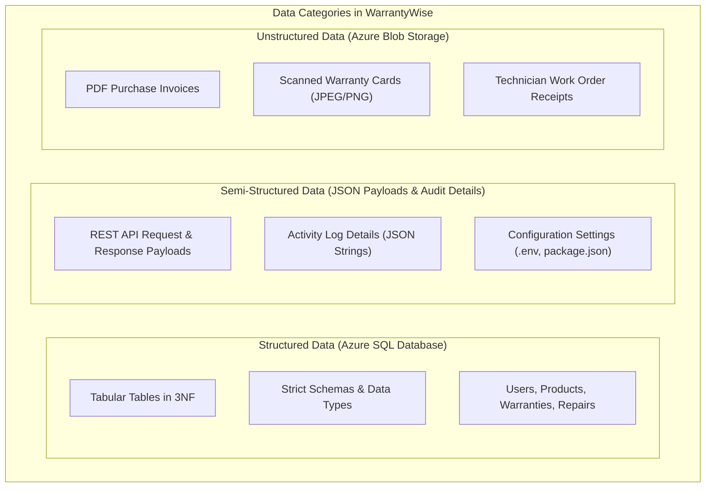
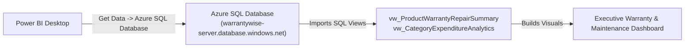

# WarrantyWise — Microsoft DP-900 / Azure Data Services Implementation Guide

## 1. Core Data Concepts in WarrantyWise

A fundamental concept in the Microsoft Certified Azure Data Fundamentals (DP-900) curriculum is understanding the three primary categories of data: **Structured**, **Semi-Structured**, and **Unstructured** data. WarrantyWise serves as a textbook real-world case study for all three.

### 1.1 Comparative Analysis

| Dimension | Structured Data | Semi-Structured Data | Unstructured Data |
| :--- | :--- | :--- | :--- |
| **Definition** | Data organized in predefined columns, rows, and mathematical relations enforcing strict schemas and relational constraints. | Data containing semantic markers or tags (like keys and values) without a fixed relational schema. | Binary or media data lacking any predefined conceptual schema or tabular model. |
| **WarrantyWise Example** | `Products` table (`purchase_price DECIMAL(18,2)`, `purchase_date DATE`), `Users` table, `Warranties` table. | JSON REST API payloads (`/api/analytics/dashboard`), user settings, audit logs. | Scanned PDF purchase invoices, camera photos of warranty stickers, PDF repair receipts. |
| **Storage Engine** | **Azure SQL Database** | **Azure Cosmos DB** / In-Memory JSON | **Azure Blob Storage** (Hot / Cool Access Tiers) |
| **Query Mechanism** | Standard T-SQL, relational joins, indexes, views, stored procedures. | JSON path navigation, NoSQL query APIs. | Direct byte stream download via Azure Storage SDK. |

---

## 2. Azure SQL Database Implementation (Structured Tier)

Azure SQL Database is a fully managed Platform-as-a-Service (PaaS) database engine that handles patching, backups, replication, and high-availability without user intervention.

### 2.1 Why Azure SQL Database for WarrantyWise?
1. **Relational Integrity**: Enforces foreign keys (`ON DELETE CASCADE`), unique email addresses, and check constraints (`cost >= 0`).
2. **Built-in High Availability**: 99.99% SLA powered by Microsoft Azure.
3. **Advanced Threat Protection**: Built-in vulnerability assessment, SQL injection detection, and data masking.
4. **Transparent Data Encryption (TDE)**: Automatic AES-256 encryption at rest for database files and backups.

---

## 3. Azure Blob Storage Implementation (Unstructured Tier)

Azure Blob Storage is Microsoft's massively scalable object storage solution for storing unstructured binary data in the cloud.

### 3.1 Container Architecture
- **Storage Account**: `warrantystorage2026`
- **Container Name**: `warranty-documents`
- **Access Tier**: `Hot` (for frequently downloaded recent invoices) transitioning via Lifecycle Management to `Cool` (for warranties older than 180 days).
- **Public Access Level**: `Private (no anonymous access)`. Authenticated via Azure Managed Identity (`DefaultAzureCredential`); all documents are streamed through authenticated Express API endpoints.

---

## 4. Microsoft Power BI Integration & Reporting

Power BI connects directly to Azure SQL Database to provide executive reporting dashboards.

### 4.1 Step-by-Step Connection Guide

#### Step 1: Open Power BI Desktop
1. Click **Get Data** on the Home ribbon.
2. Select **Azure** from the categories on the left, then select **Azure SQL Database**.
3. Click **Connect**.

#### Step 2: Configure Server Connection
- **Server**: `warrantywise-server.database.windows.net`
- **Database**: `WarrantyWiseDB`
- **Data Connectivity mode**: Select **Import** (for high performance in-memory caching) or **DirectQuery** (for real-time streaming updates).
- Under Advanced Options, you can optionally supply SQL statements or directly import views.

#### Step 3: Enter Database Authentication Credentials
- Select **Database** from the left authentication tabs.
- **User name**: `warrantyadmin`
- **Password**: `<Your-Strong-Azure-SQL-Password>`
- Click **Connect**.

#### Step 4: Select Reporting Views
In the Navigator window, select the following optimized SQL views created in `database/views.sql`:
1. `vw_ProductWarrantyRepairSummary`
2. `vw_CategoryExpenditureAnalytics`
3. `vw_ExpiringWarranties30Days`

Click **Load**.

---

## 5. Sample Power BI Dashboard Design

The imported dataset powers an executive dashboard containing four key visual tiles:

### Visual Tile 1: Portfolio Health Card Matrix
- **Metric 1**: Total Asset Replacement Value (`SUM(purchase_price)`) -> e.g. `$11,455.43`
- **Metric 2**: Cumulative Repair Outlay (`SUM(total_repair_cost)`) -> e.g. `$364.00`
- **Metric 3**: Active Warranty Coverage Ratio (`COUNT(Active) / COUNT(Total)`) -> e.g. `62.5%`

### Visual Tile 2: Category Cost Breakdown (Donut Chart)
- **Legend**: `category_name`
- **Values**: `total_purchase_investment`
- **Tooltips**: `total_products`, `maintenance_cost_percentage`

### Visual Tile 3: High-Maintenance Asset Risk Scatter Plot
- **X-Axis**: Original Purchase Price
- **Y-Axis**: Cumulative Repair Spending
- **Details**: Product Name (Identifies outliers where repair costs approach 30-50% of original price).

### Visual Tile 4: Expiration Forecast Gantt / Table
- Columns: Product Name, Brand, Expiration Date, Days Remaining, User Contact.
- Conditional formatting: Rows with `<= 30 days` highlighted in bright amber/red.

