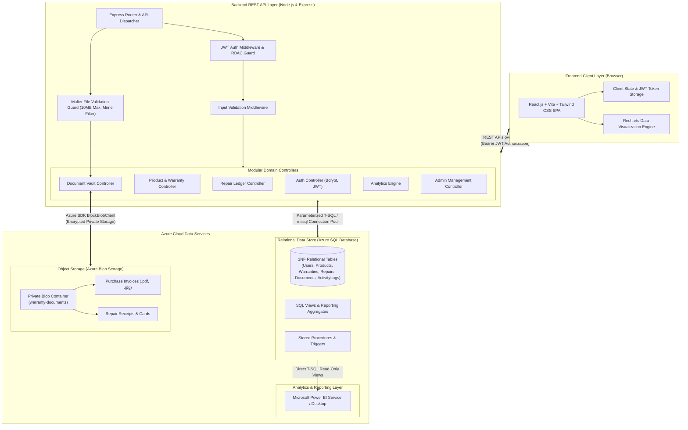
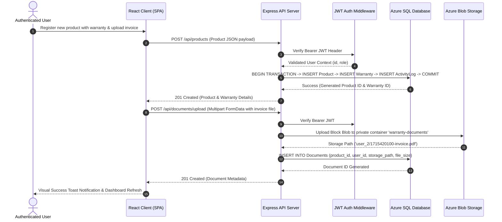

# WarrantyWise — System Design & Architecture Document

## 1. Executive Summary

**WarrantyWise** is an enterprise-grade personal and small-business warranty, invoice, and repair maintenance tracking platform. It addresses the pervasive consumer challenge of lost purchase invoices, forgotten warranty expiration deadlines, unorganized repair histories, and untracked asset maintenance expenditures.

This document describes the high-level system architecture, component boundaries, data flow pipelines, functional and non-functional requirements, security posture, and key engineering trade-offs.

---

## 2. System Architecture

WarrantyWise utilizes a **Modular Monolithic Architecture**. The system comprises a responsive React single-page application (SPA) communicating over HTTPS/REST with an Express.js application layer, backed by Microsoft Azure SQL Database for structured relational records and Azure Blob Storage for unstructured digital attachments.

### 2.1 High-Level Architecture Diagram

---

## 3. Requirements Analysis

### 3.1 Functional Requirements

1. **User Authentication & Authorization**:
   - Secure account registration and credential authentication.
   - Cryptographic password hashing using `bcrypt` (salt rounds = 10).
   - Stateless session management via JSON Web Tokens (JWT).
   - Role-Based Access Control (RBAC) separating `User` and `Admin` permissions.

2. **Product & Asset Management**:
   - Full CRUD lifecycle for consumer assets (Product Name, Brand, Model, Serial Number, Category, Purchase Date, Purchase Price, Currency, Retailer, Notes).
   - Atomic registration of assets with associated warranty terms.
   - Comprehensive multi-attribute filtering (category, brand, warranty status) and full-text keyword search.

3. **Warranty Lifecycle Management**:
   - Tracking warranty provider, policy number, warranty type (Manufacturer, Extended, Retailer, Third-Party), duration, start date, and end date.
   - Real-time dynamic calculation of expiration status: `Active`, `Expiring Soon` (<= 30 days remaining), and `Expired`.
   - Proactive alert triggers for upcoming warranty lapses.

4. **Repair & Service Tracking**:
   - Detailed maintenance ledger capturing service dates, service center names, issue descriptions, repair costs, workflow status (`Pending`, `In Progress`, `Completed`, `Cancelled`), and technician notes.
   - Automatic aggregation of cumulative repair expenditures per product and across user portfolios.

5. **Document Management**:
   - Digital upload, indexing, and categorization of invoices, warranty cards, and repair receipts.
   - File validation (MIME-type whitelist: PDF, JPEG, PNG, WebP; strict 10 MB payload limits).
   - Secure private streaming and file deletion via Azure Blob Storage / disk abstraction.

6. **Warranty Analytics Dashboard**:
   - Portfolio overview metrics (Total Products, Active Warranties, Expiring Soon, Expired, Total Repair Spend, Total Asset Value).
   - Category distribution charts.
   - Monthly maintenance expenditure trend lines.
   - Top high-cost repair assets ranking.
   - Upcoming warranty expiration alert schedule.

7. **System Administration & Auditability**:
   - Comprehensive administrative user oversight and role management.
   - Immutable audit logging (`ActivityLogs`) capturing security events, product additions, deletions, updates, and document operations.

### 3.2 Non-Functional Requirements

- **Performance**: Sub-100ms API response time for relational queries through non-clustered indexes on `user_id`, `category_id`, and `end_date`.
- **Security**: Zero credential leakage, strictly parameterized SQL queries preventing SQL Injection, sanitized inputs, and private container permissions.
- **Reliability & ACID Compliance**: Relational integrity enforced via foreign key constraints, check constraints, and atomic multi-table transactions with rollback.
- **Portability & Cloud Readiness**: Dual-engine storage and database abstraction allowing instant local execution via local persistence while supporting enterprise deployment to Azure SQL Database and Azure Blob Storage.
- **Scalability**: Modular controller and service architecture permitting horizontal scaling behind Azure App Service and Azure Traffic Manager.

---

## 4. Architectural Trade-Off Analysis

### Modular Monolith vs. Microservices Architecture

An important architectural decision for WarrantyWise was selecting a **Modular Monolith** rather than a distributed **Microservices** architecture.

| Evaluation Dimension | Modular Monolith (WarrantyWise Decision) | Microservices Architecture |
| :--- | :--- | :--- |
| **System Complexity** | Low to moderate. Single deployment pipeline, shared configuration, straightforward debugging and tracing. | High. Requires service discovery, distributed tracing, API gateways, independent deployment pipelines. |
| **Data Integrity & Consistency** | **ACID compliant**. Multi-table atomic transactions (e.g. creating product + warranty together) execute within a single database transaction with instant rollback on failure. | **Eventual consistency**. Requires complex distributed transaction patterns (Saga pattern, two-phase commits, distributed messaging brokers like Kafka or RabbitMQ). |
| **Network Overhead & Latency** | **Zero internal latency**. Module calls occur in-process via fast memory function invocations. | **High latency**. Inter-service REST/gRPC calls introduce serialization overhead, connection pooling bottlenecks, and network failure modes. |
| **Development & Operational Velocity** | Ideal for high developer velocity, university evaluation, and single-team development. Easy local spin-up with zero Docker dependencies. | Requires Kubernetes / container orchestration, complex environment variables, and substantial infrastructure operational costs. |
| **Resource Cost** | Minimal memory footprint (~50MB Node.js process). Can run on Azure App Service Basic tier. | Substantial compute overhead running 5-7 independent microservice containers and message brokers ($300+/month). |

**Conclusion**: For a personal and small-business warranty platform, a modular monolith provides optimal maintainability, immediate transactional consistency, lower cloud hosting expenses, and rapid operational reliability without the artificial overhead of distributed microservices.

---

## 5. End-to-End Data Flow

